<div align="center">

<picture>
  
</picture>

### Practice Dutch one quick game at a time: vocabulary, listening, sentences, grammar and pronunciation, all in your browser.

<p>
  
  
  
  
  
  
</p>

<p>
  <a href="https://altinayselman.github.io/Nederlands-App/"><b>Play it live</b></a>
  &nbsp;&middot;&nbsp;
  <a href="docs/media/nederlands-app-film.mp4"><b>Watch the film</b></a>
  &nbsp;&middot;&nbsp;
  <a href="#the-games"><b>The games</b></a>
  &nbsp;&middot;&nbsp;
  <a href="#getting-started"><b>Run it locally</b></a>
</p>

<a href="docs/media/nederlands-app-film.mp4">
  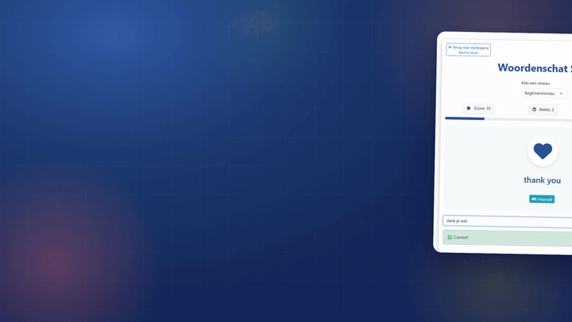
</a>

<sub><b>Watch the 33-second film</b> (MP4, sound on): every screen in it is a real recording of the live site.</sub>

</div>

---

## Why Leer Nederlands

Learning a language sticks when you use it a little every day. **Leer Nederlands** (Dutch for "Learn Dutch") turns that daily practice into short games you can start in one click: no account, no install, no app store. Every screen is bilingual, with the Dutch first and the English underneath, so beginners always know what to do.

<table>
  <tr>
    <td width="33%" valign="top"><br><b>Vocabulary with streaks</b><br>See the English word and an icon, type the Dutch. Every third correct answer in a row adds bonus points.</td>
    <td width="33%" valign="top"><br><b>Listen and write</b><br>The browser reads a Dutch sentence aloud (two plays per sentence) and you type what you hear. 156 sentences in three levels.</td>
    <td width="33%" valign="top"><br><b>Match images</b><br>A memory game: flip cards to pair each Dutch word with its picture before the 60-second clock runs out.</td>
  </tr>
  <tr>
    <td valign="top"><br><b>Build sentences</b><br>Tap scrambled words into the right order. Correct sentences show their English meaning.</td>
    <td valign="top"><br><b>Grammar with rules</b><br>Each exercise shows the rule and an example first (de/het articles, the verb <i>zijn</i> and more), with a hint button.</td>
    <td valign="top"><br><b>Pronunciation</b><br>Hear the word, read the phonetic tip, then speak it. Your browser's speech recognition checks the result.</td>
  </tr>
  <tr>
    <td valign="top"><br><b>Quiz Master</b><br>A mixed quiz across four categories: vocabulary, grammar, listening and pronunciation.</td>
    <td valign="top"><br><b>Profile and badges</b><br>A local profile tracks your total score, badges and practice time in your own browser.</td>
    <td valign="top"><br><b>Works anywhere</b><br>Plain HTML, CSS and JavaScript on GitHub Pages, responsive from phone to desktop.</td>
  </tr>
</table>

## The games

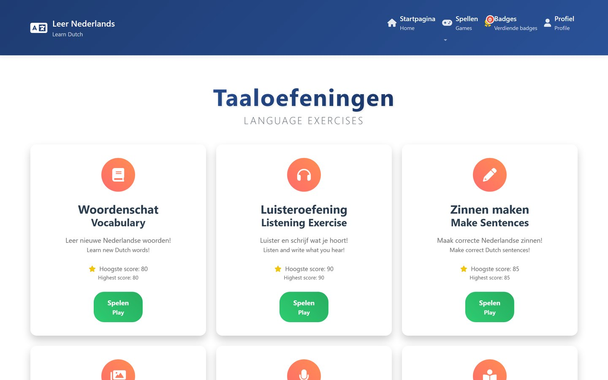

<table>
  <tr>
    <td width="50%" valign="top">
      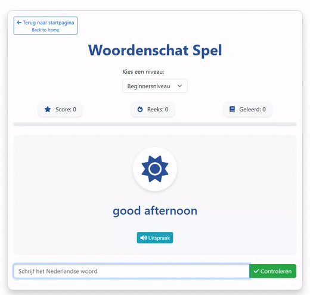
    </td>
    <td width="50%" valign="top">
      <h3>Woordenschat &middot; Vocabulary</h3>
      <p>The game shows an English word with an icon. Type the Dutch word and press Enter. A correct answer earns the word's points. Each third answer in a row adds a +5 bonus step and a streak message. Press <b>Uitspraak</b> to hear the word in Dutch.</p>
      <p>Three levels (<i>Beginnersniveau</i>, <i>Middenniveau</i>, <i>Gevorderd niveau</i>), from <i>goedemorgen</i> to <i>verantwoordelijkheid</i>.</p>
    </td>
  </tr>
  <tr>
    <td valign="top">
      <h3>Afbeeldingen koppelen &middot; Match images</h3>
      <p>Twelve face-down cards hide six words and six pictures. Flip two at a time to find the pairs before the 60-second timer runs out. Each level has its own set, from <i>huis</i> and <i>auto</i> to <i>universiteit</i> and <i>muziek</i>.</p>
    </td>
    <td valign="top">
      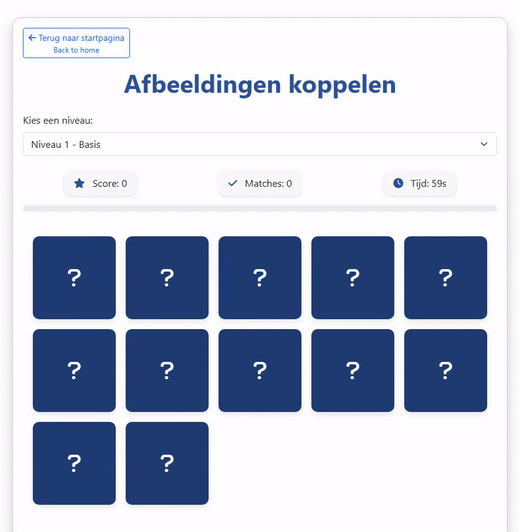
    </td>
  </tr>
</table>

<table>
  <tr>
    <td width="33%" align="center">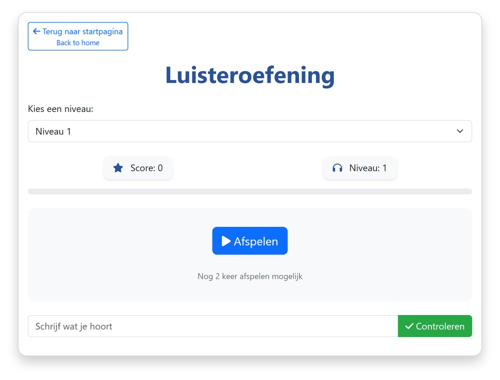<br><sub><b>Luisteroefening</b>: listen, then write what you hear</sub></td>
    <td width="33%" align="center">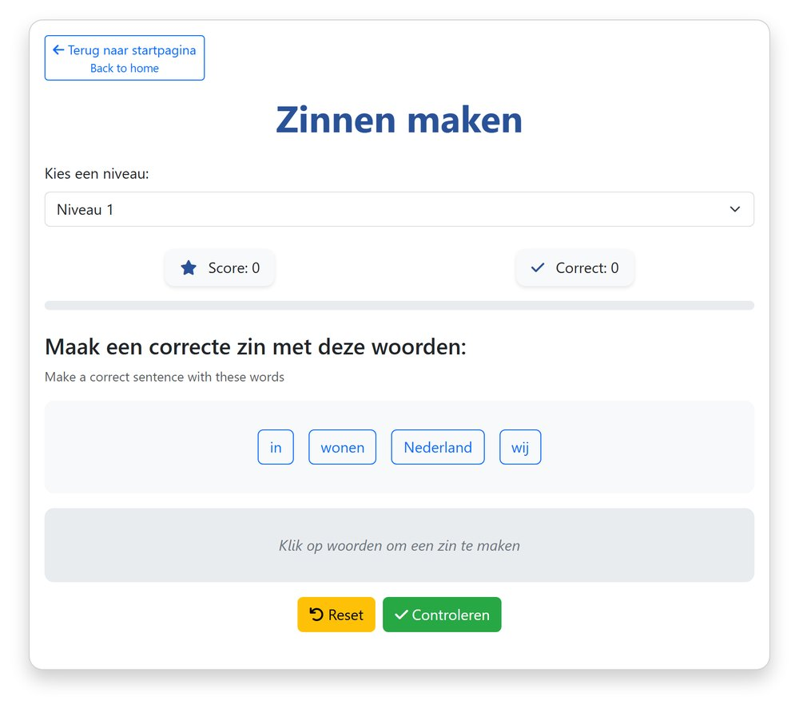<br><sub><b>Zinnen maken</b>: tap the words into a sentence</sub></td>
    <td width="33%" align="center">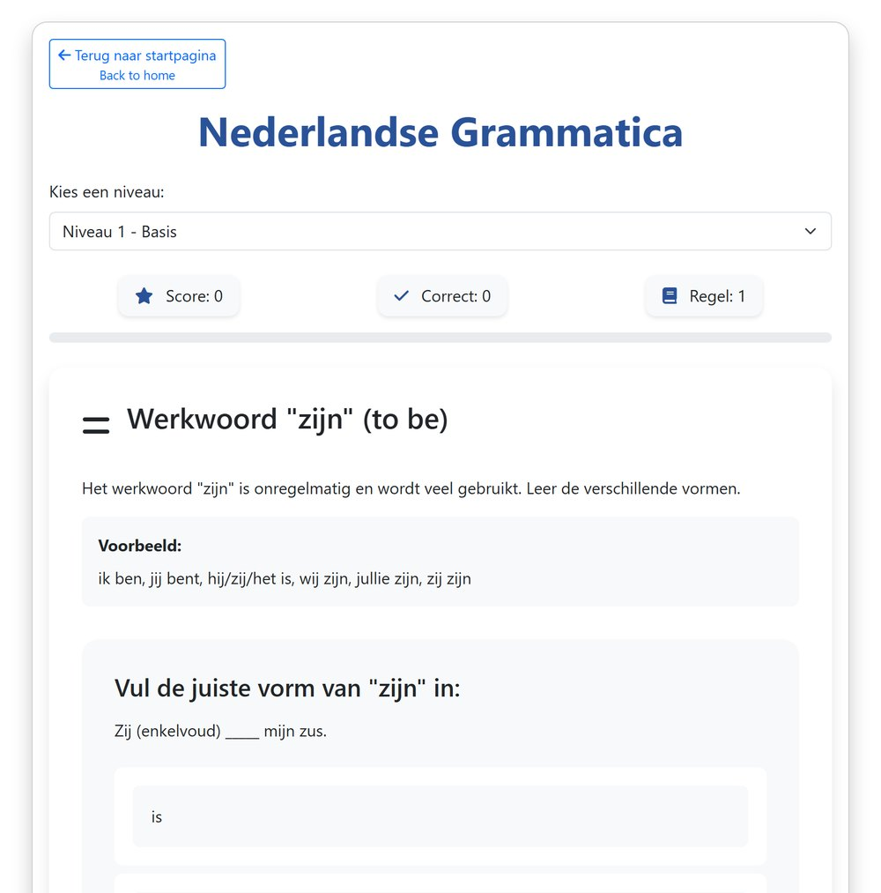<br><sub><b>Grammatica</b>: rule, example, question and hint</sub></td>
  </tr>
  <tr>
    <td align="center">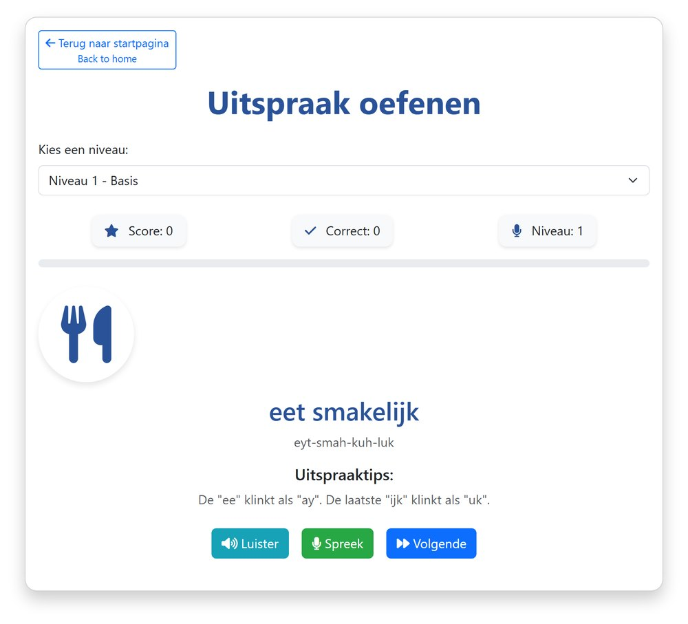<br><sub><b>Uitspraak</b>: phonetic tip, listen, speak</sub></td>
    <td align="center">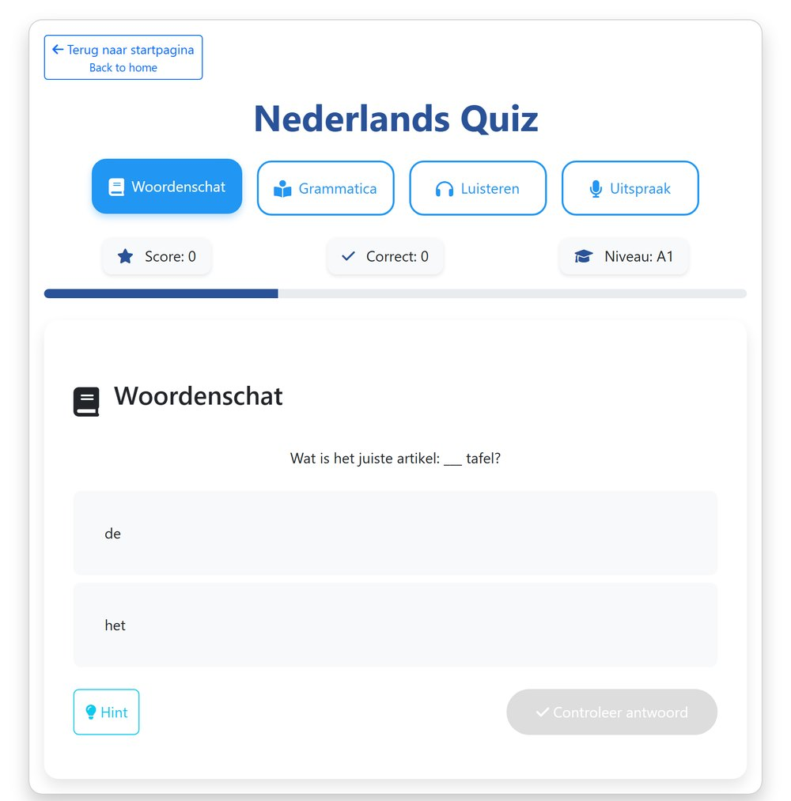<br><sub><b>Nederlands Quiz</b>: four categories in one quiz</sub></td>
    <td align="center">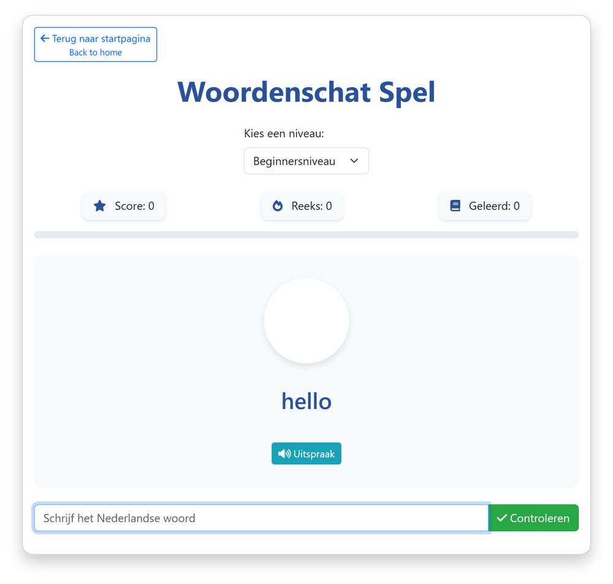<br><sub><b>Woordenschat</b>: three levels of words</sub></td>
  </tr>
</table>

<details>
<summary><b>On a phone</b> (390 px wide, real captures)</summary>
<br>
<table>
  <tr>
    <td align="center">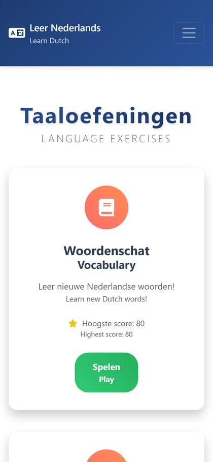<br><sub>Home</sub></td>
    <td align="center">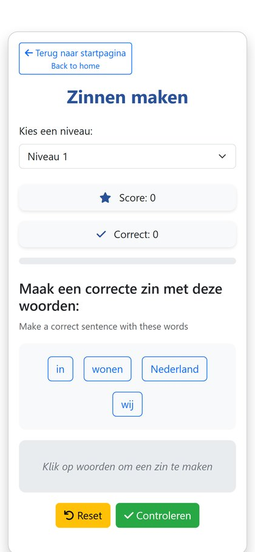<br><sub>Zinnen maken</sub></td>
    <td align="center">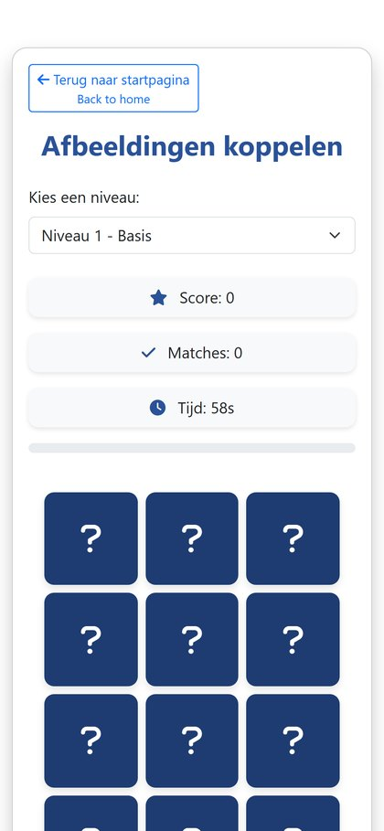<br><sub>Afbeeldingen koppelen</sub></td>
  </tr>
</table>
</details>

### What is inside each game

| Game | Page | Levels | Content in the code |
| --- | --- | --- | --- |
| Vocabulary | `woorden-spel.html` | 3 | 30 words with icons and point values |
| Listening | `luister-spel.html` | 3 | 156 Dutch sentences with English translations |
| Sentences | `zinnen-spel.html` | 3 | 12 scrambled sentences |
| Match images | `afbeeldingen-spel.html` | 3 | 18 word and picture pairs, 60 s timer |
| Pronunciation | `uitspraak-spel.html` | 3 | 24 words with phonetic spelling and tips |
| Grammar | `grammatica-spel.html` | 3 | 27 exercises over 6 rules |
| Quiz Master | `quiz-spel.html` | 4 categories | 11 mixed questions (choice, audio, speaking) |
| Badges | `badges.html` | | 6 badge definitions with requirements and rewards |

## How it works

The app is a set of static pages. Each game page loads one script that holds its own exercises, scoring and feedback. Browser APIs do the heavy lifting: the Web Speech API speaks Dutch (`nl-NL`) and recognises speech, and `localStorage` keeps the profile.

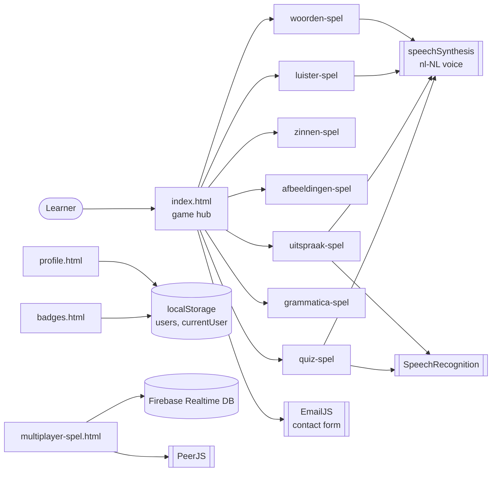

- **Scoring:** each game keeps its own score, progress bar and level. The vocabulary game adds a streak bonus (`floor(streak / 3) * 5`). The listening game allows two plays per sentence.
- **Speech:** pronunciation and the quiz's speaking questions use `SpeechRecognition` / `webkitSpeechRecognition`, so they need a browser that supports it (for example Chrome or Edge) and microphone permission. Listening and "Uitspraak" buttons use `speechSynthesis` with the `nl-NL` voice installed on your device.
- **Profiles:** sign-up and sign-in on `profile.html` are local demo accounts stored in the browser's `localStorage`. They never leave your device and are not a secure login.
- **Multiplayer (experimental):** `multiplayer-spel.html` is a room-based quiz lobby built on Firebase Realtime Database and PeerJS. It is not linked from the home page.

## Tech stack

| Layer | Technology |
| --- | --- |
| Pages | HTML5, one page per game |
| Styling | CSS3 (`style.css`, `game-styles.css`), Bootstrap 5.3 (CDN), Font Awesome 6 (CDN) |
| Logic | Vanilla JavaScript, no build step |
| Speech | Web Speech API: `speechSynthesis` and `SpeechRecognition` |
| Storage | Browser `localStorage` |
| Contact | EmailJS browser SDK |
| Multiplayer prototype | Firebase Realtime Database (compat SDK 9.6), PeerJS 1.4.7 |
| Room server prototype | `server.js`: Node.js, Express and Socket.IO (optional, not used by the pages) |
| Hosting | GitHub Pages, served from the `main` branch root |

## Getting started

**Play online:** open <https://altinayselman.github.io/Nederlands-App/> and pick a game.

**Run it locally.** There is nothing to build. Serve the folder with any static web server so the pages and speech features behave as they do online:

```bash
git clone https://github.com/altinayselman/Nederlands-App.git
cd Nederlands-App

# any static server works, for example:
python -m http.server 8080
# or
npx serve .
```

Then open the address the server prints (port 8080 in the first example). Opening `index.html` directly from disk also works for most games.

**Requirements**

- A modern browser. For the pronunciation game and speaking questions, use a browser with speech recognition (for example Chrome or Edge) and allow microphone access.
- An internet connection for the CDN assets (Bootstrap, Font Awesome) and the optional EmailJS and Firebase features.
- There are no environment variables and no API keys to set.

<details>
<summary><b>Optional: the Socket.IO room server prototype</b></summary>
<br>

`server.js` is a small Express and Socket.IO server that creates four-letter room codes, lets up to eight players join a room, hands over the host role when the host leaves and broadcasts `gameStarted`. The pages do not use it, and the repository has no `package.json`, so install its two dependencies yourself:

```bash
npm install express socket.io
node server.js        # listens on PORT, default 3000, and serves ./public
```

Socket events: `createRoom`, `joinRoom`, `startGame` (client to server); `roomCreated`, `joinedRoom`, `playerJoined`, `playerLeft`, `newHost`, `gameStarted`, `joinError` (server to client).
</details>

## Project structure

```text
Nederlands-App/
├── index.html                 # game hub, Quiz Master card, contact form
├── woorden-spel.html/.js      # vocabulary
├── luister-spel.html/.js      # listening
├── zinnen-spel.html/.js       # sentence builder
├── afbeeldingen-spel.html/.js # match images
├── uitspraak-spel.html/.js    # pronunciation
├── grammatica-spel.html/.js   # grammar
├── quiz-spel.html/.js         # Quiz Master
├── badges.html/.js            # badge overview
├── profile.html/.js           # local profile and statistics
├── multiplayer-spel.html/.js  # experimental multiplayer lobby
├── kelime-oyunu, cumle-oyunu, dinleme-oyunu (.html/.js), script.js
│                              # earlier Turkish-Dutch versions of the games
├── contact.js                 # EmailJS contact form
├── server.js                  # optional Socket.IO room server prototype
├── style.css, game-styles.css # shared styles
└── docs/media/                # README images, GIFs and film
```

## FAQ

<details>
<summary><b>Do I need an account?</b></summary>
<br>
No. Every game works straight away. The profile page lets you create a local profile to see your score, badges and practice time, but it is stored only in your browser.
</details>

<details>
<summary><b>Why does the pronunciation game not hear me?</b></summary>
<br>
It uses your browser's speech recognition. Use a browser that supports it (for example Chrome or Edge), allow microphone access, and open the site over <code>https</code> (as on GitHub Pages) or from a local server on your own machine.
</details>

<details>
<summary><b>Which Dutch voice will I hear?</b></summary>
<br>
The games use the Dutch (<code>nl-NL</code>) text-to-speech voice of your operating system or browser, so it can sound different from device to device.
</details>

<details>
<summary><b>Can I add my own words or sentences?</b></summary>
<br>
Yes. Each game keeps its content in a plain object at the top of its script, for example <code>wordCategories</code> in <code>woorden-spel.js</code>, <code>audioExercises</code> in <code>luister-spel.js</code> and <code>grammarExercises</code> in <code>grammatica-spel.js</code>. Add entries in the same shape and reload the page.
</details>

<details>
<summary><b>Nederlands: over deze app</b> (original Dutch README text)</summary>
<br>

Welkom bij Nederlands-App! Dit is een interactieve applicatie waarmee je op een leuke en effectieve manier Nederlands kunt leren. Of je nu je woordenschat wilt uitbreiden, grammatica wilt oefenen of luistervaardigheid wilt verbeteren, deze app biedt verschillende spelletjes om je te helpen!

**Features:** Afbeeldingen Spel (leer woorden met afbeeldingen), Badges Systeem (verdien badges terwijl je vooruitgang boekt), Zinnen Spel (oefen met Nederlandse zinnen), Luister Spel (verbeter je luistervaardigheid), Quiz Spel (test je kennis met uitdagende vragen), Grammatica Spel (leer en oefen grammatica), Woorden Spel (breid je woordenschat uit), Uitspraak Spel (oefen de correcte uitspraak).

**Hoe te gebruiken:** open de app en kies een spel. Volg de instructies op het scherm en speel het spel. Verdien punten en badges terwijl je leert! Klaar met een spel? Druk op de opnieuw spelen knop om opnieuw te beginnen.

**Technologieën:** HTML (structuur), CSS (stijl en design), JavaScript (interactiviteit en spelmechanieken).
</details>

## Contributing

Want to help? Pull requests and issues are welcome: new words, sentences, grammar rules, translations or bug fixes. Keep each game's content in its existing data object so the other games stay untouched.

---

<div align="center">

**Licence:** the original README describes the app as open source under the MIT licence. The repository does not contain a separate `LICENSE` file.

Built by **[Rui Codex](https://ruicodex.com)**

<sub>Media credits: all screenshots, GIFs and film footage are real captures of the live GitHub Pages site, recorded in a headless browser. Banner, badges and icons were drawn as SVG for this README. Narration is Kokoro TTS (voice af_heart), generated locally. Music and sound effects were synthesised in code. No generated imagery is used.</sub>

</div>
